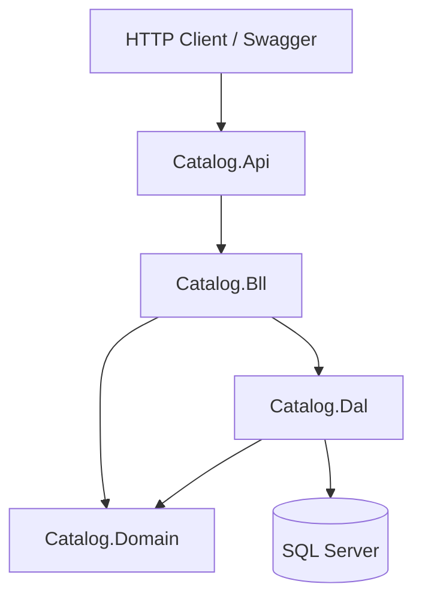

# Clinic Catalog Service

Сервіс каталогу медичних послуг та обладнання для інформаційної системи клініки. Реалізований на .NET 10, ASP.NET Core Web API, Entity Framework Core та SQL Server.

## 1. Можливості

- CRUD-операції для категорій медичних послуг та самих послуг.
- Фільтрація за назвою, категорією, ціною та статусом активності.
- Сортування за назвою, ціною, тривалістю, статусом та ідентифікатором.
- Пагінація з розміром сторінки від 1 до 100.
- Eager Loading, Explicit Loading та LINQ-запити.
- Generic Repository, Unit of Work та Specification Pattern.
- DTO й AutoMapper.
- DataAnnotations і FluentValidation.
- Централізована обробка винятків у форматі ProblemDetails.
- Логування HTTP-запитів і помилок через Serilog.
- EF Core Code First та migrations.
- Ідемпотентне початкове наповнення бази в середовищі Development.
- Unit-тести доменної логіки та Specification Pattern.

## 2. Структура проєкту

```text
Services/Catalog/
├── Catalog.Api/
│   ├── Controllers/
│   ├── Data/
│   ├── Exceptions/
│   ├── Filters/
│   ├── Validators/
│   └── Program.cs
├── Catalog.Bll/
│   ├── DTOs/
│   ├── Interfaces/
│   ├── Mapping/
│   ├── Services/
│   └── DependencyInjection.cs
├── Catalog.Dal/
│   ├── Configurations/
│   ├── Interfaces/
│   ├── Models/
│   ├── Persistence/Migrations/
│   ├── Repositories/
│   ├── Specifications/
│   └── UnitOfWork/
├── Catalog.Domain/
│   ├── Entities/
│   ├── Exceptions/
│   └── Specifications/
└── Catalog.Tests/
    ├── Domain/
    └── Specifications/
```

| Проєкт | Відповідальність |
|---|---|
| `Catalog.Domain` | Доменні сутності, правила предметної області, винятки та специфікації |
| `Catalog.Dal` | EF Core, Fluent API, міграції, репозиторії, Unit of Work та виконання специфікацій |
| `Catalog.Bll` | Бізнес-сервіси, DTO, AutoMapper та координація операцій |
| `Catalog.Api` | REST API, контролери, валідація, обробка помилок, логування та запуск |
| `Catalog.Tests` | Unit-тести доменної логіки та перевірки специфікацій |

## 3. Архітектура



API приймає HTTP-запит і викликає BLL. BLL виконує бізнес-операцію та працює з абстракціями DAL і доменною моделлю. DAL виконує EF Core-запити до SQL Server. Domain містить сутності, бізнес-правила та специфікації.

Детальна схема міститься у [документації архітектури](../../docs/architecture.md).

## 4. Доменна модель

| Сутність | Призначення |
|---|---|
| `ServiceCategory` | Категорія медичних послуг |
| `Equipment` | Медичне обладнання |
| `MedicalService` | Медична послуга |
| `ServiceDetail` | Додаткова інформація про послугу |
| `ServicePackage` | Комплексний пакет послуг |
| `PackageService` | Проміжна сутність зв'язку пакета та послуги |

Основні зв'язки: категорія має багато послуг; обладнання може бути пов'язане з багатьма послугами; послуга має необов'язкові деталі; пакети та послуги пов'язані багато-до-багатьох через `PackageService`.

## 5. Технології

- .NET 10 та C#
- ASP.NET Core Web API
- Entity Framework Core 10 та Microsoft SQL Server
- EF Core Code First, Fluent API та Migrations
- AutoMapper
- FluentValidation і DataAnnotations
- Serilog
- Swashbuckle / Swagger
- xUnit та EF Core InMemory

## 6. Вимоги для запуску

Потрібні .NET SDK 10, SQL Server, доступний за `localhost,1433`, та глобальний інструмент `dotnet-ef` версії `10.0.15`.

Перевірка SDK:

```bash
dotnet --version
```

Встановити EF CLI, якщо він ще не встановлений:

```bash
dotnet tool install --global dotnet-ef --version 10.0.15
```

Оновити наявний інструмент:

```bash
dotnet tool update --global dotnet-ef --version 10.0.15
```

## 7. Налаштування SQL Server

Сервіс використовує базу даних `ClinicCatalogEfDb` і конфігураційний ключ `ConnectionStrings:CatalogDb`.

Якщо User Secrets ще не ініціалізовано:

```bash
dotnet user-secrets init --project Services/Catalog/Catalog.Api
```

Зберегти локальний рядок підключення:

```bash
dotnet user-secrets set "ConnectionStrings:CatalogDb" "Server=localhost,1433;Database=ClinicCatalogEfDb;User Id=sa;Password=YOUR_PASSWORD;Encrypt=True;TrustServerCertificate=True;" --project Services/Catalog/Catalog.Api
```

Замість `YOUR_PASSWORD` використайте локальний пароль SQL Server. Не додавайте реальний пароль до `appsettings.json`, README або Git. У репозиторії не повинно бути секретів.

## 8. Міграції та база даних

Файли міграцій розташовані в `Catalog.Dal/Persistence/Migrations/`.

Переглянути міграції:

```bash
dotnet ef migrations list --project Services/Catalog/Catalog.Dal --startup-project Services/Catalog/Catalog.Api
```

Застосувати наявні міграції:

```bash
dotnet ef database update --project Services/Catalog/Catalog.Dal --startup-project Services/Catalog/Catalog.Api
```

Створити нову міграцію після зміни моделі:

```bash
dotnet ef migrations add MigrationName --project Services/Catalog/Catalog.Dal --startup-project Services/Catalog/Catalog.Api
```

`InitialCreate` вже існує — повторно створювати її не потрібно.

## 9. Збірка та запуск

Команди виконуються з кореневого каталогу репозиторію:

```bash
dotnet restore Platform.slnx
dotnet build Platform.slnx
```

Запустити API з HTTP-профілем:

```bash
dotnet run --project Services/Catalog/Catalog.Api --launch-profile http
```

Поточний HTTP-порт з `launchSettings.json` — `5122`. Swagger UI доступний за адресою:

```text
http://localhost:5122/swagger
```

Профіль `http` задає `ASPNETCORE_ENVIRONMENT=Development`. У цьому середовищі під час старту API виконується `CatalogDbSeeder`. Seeder додає відсутні демонстраційні категорії, обладнання та послуги. Повторний запуск не повинен створювати дублікати. Міграції застосовуються окремою командою `dotnet ef database update`.

## 10. REST API

### Категорії послуг

Базовий маршрут: `/api/ServiceCategories`.

| Метод | Маршрут | Призначення |
|---|---|---|
| GET | `/api/ServiceCategories` | Отримати всі категорії |
| GET | `/api/ServiceCategories/{id}` | Отримати категорію за ID |
| POST | `/api/ServiceCategories` | Створити категорію |
| PUT | `/api/ServiceCategories/{id}` | Оновити категорію |
| DELETE | `/api/ServiceCategories/{id}` | Видалити категорію |

Тіло POST-запиту:

```json
{
  "categoryName": "Diagnostics",
  "description": "Diagnostic medical services."
}
```

### Медичні послуги

Базовий маршрут: `/api/MedicalServices`.

| Метод | Маршрут | Призначення |
|---|---|---|
| GET | `/api/MedicalServices` | Отримати сторінку послуг із фільтрами |
| GET | `/api/MedicalServices/{id}` | Отримати послугу за ID |
| GET | `/api/MedicalServices/search` | Пошук послуг |
| GET | `/api/MedicalServices/top-by-price` | Отримати найдорожчі послуги |
| POST | `/api/MedicalServices` | Створити послугу |
| PUT | `/api/MedicalServices/{id}` | Оновити послугу |
| DELETE | `/api/MedicalServices/{id}` | Видалити послугу |

Тіло POST-запиту:

```json
{
  "categoryId": 1,
  "equipmentId": null,
  "serviceName": "Abdominal Ultrasound",
  "price": 850.00,
  "durationMinutes": 20
}
```

`categoryId` має відповідати наявній категорії в базі даних.

### Пошук, сортування та пагінація

`GET /api/MedicalServices` приймає параметри:

| Параметр | Тип | Призначення |
|---|---|---|
| `name` | string | Пошук за назвою |
| `categoryId` | long | Фільтр за категорією |
| `minPrice` | decimal | Мінімальна ціна |
| `maxPrice` | decimal | Максимальна ціна |
| `isActive` | bool | Статус активності |
| `pageNumber` | int | Номер сторінки, від 1 |
| `pageSize` | int | Розмір сторінки, від 1 до 100 |
| `sortBy` | string | Поле сортування |
| `sortDescending` | bool | Сортування за спаданням |

Дозволені значення `sortBy`: `serviceName`, `price`, `durationMinutes`, `isActive`, `serviceId`.

Приклади запитів:

```text
GET /api/MedicalServices?pageNumber=1&pageSize=10
GET /api/MedicalServices?name=Ultrasound
GET /api/MedicalServices?categoryId=1&isActive=true
GET /api/MedicalServices?minPrice=300&maxPrice=900
GET /api/MedicalServices?pageNumber=1&pageSize=3&sortBy=price&sortDescending=true
GET /api/MedicalServices/top-by-price?count=5
```

Відповідь пагінації має структуру:

```json
{
  "items": [],
  "pageNumber": 1,
  "pageSize": 10,
  "totalCount": 0,
  "totalPages": 0,
  "hasPreviousPage": false,
  "hasNextPage": false
}
```

Значення `items` та лічильників залежить від даних у базі.

## 11. Валідація, помилки та логування

DataAnnotations перевіряють обов'язковість полів, довжини та базові діапазони. FluentValidation додає правила, зокрема перевірку діапазону цін і підтримуваних полів сортування.

`GlobalExceptionHandler` повертає помилки у форматі ProblemDetails. Основні відповідності:

| Помилка | HTTP-статус |
|---|---|
| `NotFoundException` | 404 |
| `DomainException` | 400 |
| `ArgumentException` | 400 |
| `DbUpdateConcurrencyException` | 409 |
| Непередбачений виняток | 500 |

Відповідь містить `traceId` для зіставлення з серверним журналом. Serilog журналює HTTP-запити, статуси відповідей та помилки; поточний sink виводить повідомлення в консоль.

## 12. Repository, Unit of Work і Specification Pattern

`IGenericRepository<TEntity>` надає загальні операції читання та зміни сутностей. `IMedicalServiceRepository` містить спеціалізовані запити для медичних послуг. `IUnitOfWork` об'єднує репозиторії та керує збереженням змін і транзакціями.

Специфікації описують умови вибірки у Domain. `SpecificationEvaluator<TEntity>` у DAL перетворює критерії, Include, сортування та пагінацію на EF Core `IQueryable`.

Реалізовані приклади: `ActiveMedicalServicesSpecification` і `MedicalServicesByCategorySpecification`.

## 13. Тестування

Тести розташовані в `Services/Catalog/Catalog.Tests/`. Використовуються xUnit та EF Core InMemory. Набір перевіряє доменні правила категорій і послуг, активацію/деактивацію, фільтрацію специфікацій, сортування, Include та пагінацію.

Запустити всі тести рішення:

```bash
dotnet test Platform.slnx
```

Запустити лише Catalog.Tests:

```bash
dotnet test Services/Catalog/Catalog.Tests/Catalog.Tests.csproj
```

InMemory-тести ізолюють логіку LINQ та специфікацій від реального SQL Server; вони не замінюють перевірок поведінки SQL Server.

## 14. Фінальна перевірка

```bash
dotnet restore Platform.slnx
dotnet build Platform.slnx
dotnet test Platform.slnx
git diff --check
git status
```

Перед комітом перевірте, що збірка й тести успішні, міграції присутні, Swagger відкривається, демонстраційні дані не дублюються, а секрети не потрапили до Git.