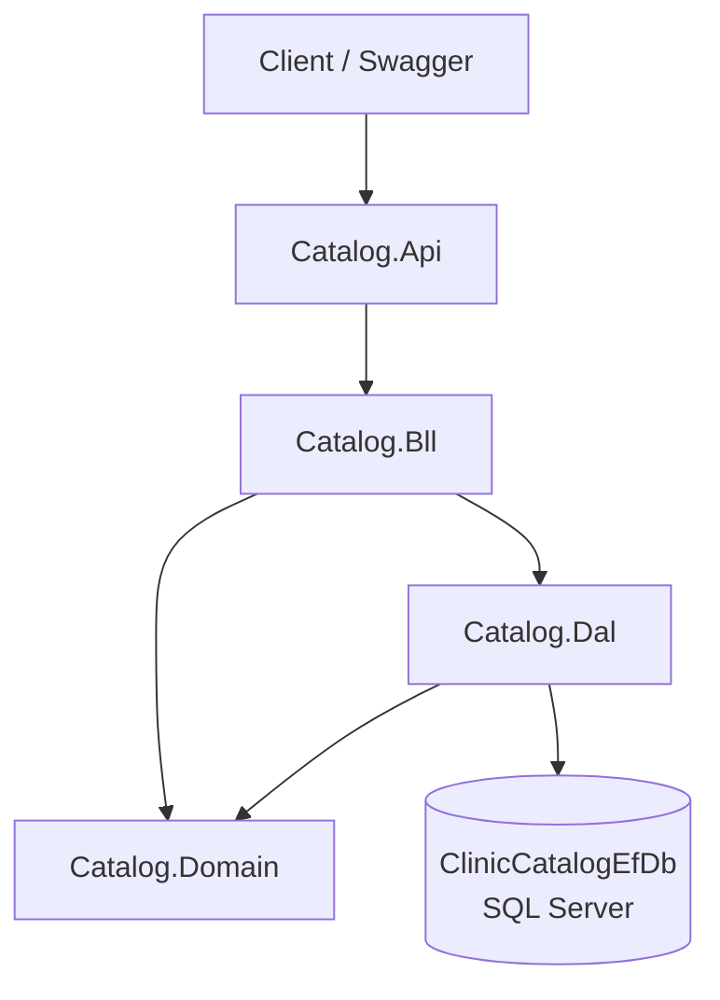
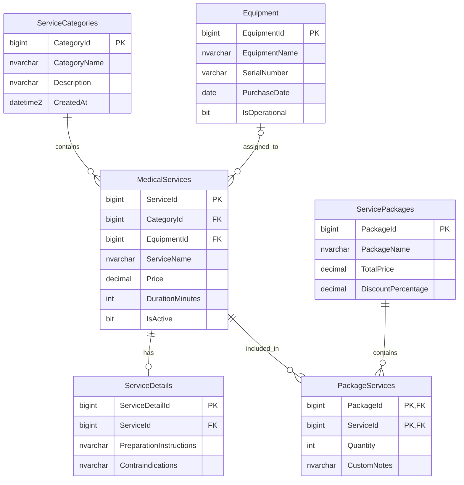

# Catalog Service — Architecture

## 1. Загальна архітектура

Catalog — окремий сервіс предметної області клініки. Його відповідальність — зберігання та надання інформації про категорії, медичні послуги, обладнання та пакети послуг.

Сервіс використовує тришарову архітектуру: Presentation Layer (`Catalog.Api`), Business Logic Layer (`Catalog.Bll`) та Data Access Layer (`Catalog.Dal`). `Catalog.Domain` містить доменну модель і правила предметної області.

## 2. Діаграма залежностей

### Потік виконання запиту

1. Клієнт надсилає HTTP-запит до API.
2. MVC перевіряє модель; FluentValidation action filter виконує додаткові правила DTO.
3. Контролер викликає відповідний BLL-сервіс.
4. BLL виконує бізнес-операцію та звертається до DAL через інтерфейси.
5. DAL формує EF Core-запит або змінює стан сутностей.
6. Unit of Work зберігає зміни в SQL Server.
7. BLL повертає DTO, API формує HTTP-відповідь.
8. Serilog журналює HTTP-запит, а глобальний обробник перетворює винятки на ProblemDetails.

## 3. Domain Layer

Основні доменні сутності: `ServiceCategory`, `Equipment`, `MedicalService`, `ServiceDetail`, `ServicePackage`, `PackageService`.

Доменна модель контролює обов'язкові назви, довжини текстових полів, невід'ємну ціну, додатну тривалість послуг, коректність ідентифікаторів та допустимі знижки пакетів. Доменні помилки представлені `DomainException`.

### Specification Pattern

`ISpecification<TEntity>` описує критерій вибірки, навігаційні властивості для Include, сортування та параметри пагінації. `BaseSpecification<TEntity>` надає базову реалізацію.

Приклади специфікацій: `ActiveMedicalServicesSpecification` та `MedicalServicesByCategorySpecification`.

## 4. Data Access Layer

DAL використовує Entity Framework Core. `CatalogDbContext` надає DbSet для шести сутностей. Таблиці, ключі, властивості та зв'язки налаштовуються через окремі Fluent API configurations.

### Repository Pattern

`IGenericRepository<TEntity>` визначає операції `GetByIdAsync`, `GetAllAsync`, `ListAsync`, `AddAsync`, `Update` та `Remove`.

`IMedicalServiceRepository` містить спеціалізовані запити з Eager Loading, Explicit Loading, пошуком, фільтрацією, сортуванням та пагінацією.

### Unit of Work

`IUnitOfWork` об'єднує репозиторії, надає `SaveChangesAsync` та керує транзакціями.

### Specification Evaluator

`SpecificationEvaluator<TEntity>` у DAL перетворює специфікацію на `IQueryable<TEntity>`:

1. застосовує Criteria;
2. додає Include;
3. застосовує сортування;
4. застосовує Skip і Take.

Умови вибірки залишаються відокремленими від механізму виконання EF Core.

## 5. Business Logic Layer

BLL містить DTO для створення, читання й оновлення, інтерфейси сервісів, реалізації `ServiceCategoryService` і `MedicalServiceService`, профіль AutoMapper та перетворення доменних сутностей на DTO. BLL не формує HTTP-відповідей і не залежить від HTTP-контексту.

## 6. API Layer

Контролери: `ServiceCategoriesController` та `MedicalServicesController`.

Додаткові компоненти:

- `FluentValidationActionFilter` — запускає валідатори DTO;
- `GlobalExceptionHandler` — централізовано обробляє винятки;
- `CatalogDbSeeder` — додає початкові дані в Development;
- Serilog — логування HTTP-запитів і помилок;
- Swagger — інтерактивна документація API.

## 7. ER-діаграма

## 8. Обробка помилок

Вхідні дані перевіряються DataAnnotations та FluentValidation. `GlobalExceptionHandler` повертає ProblemDetails із `traceId`.

| Тип помилки | HTTP-статус |
|---|---:|
| `NotFoundException` | 404 |
| `DomainException` | 400 |
| `ArgumentException` | 400 |
| `DbUpdateConcurrencyException` | 409 |
| Інші винятки | 500 |

## 9. Тестування

`Catalog.Tests` містить unit-тести доменних сутностей та тести Specification Pattern. Для ізольованих перевірок EF Core-запитів використовується InMemory provider. Перевіряються бізнес-інваріанти, фільтрація, сортування, Include та пагінація.